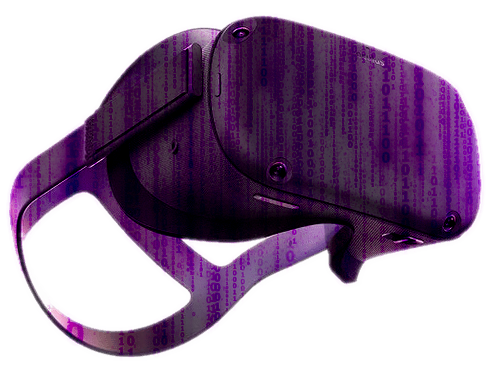
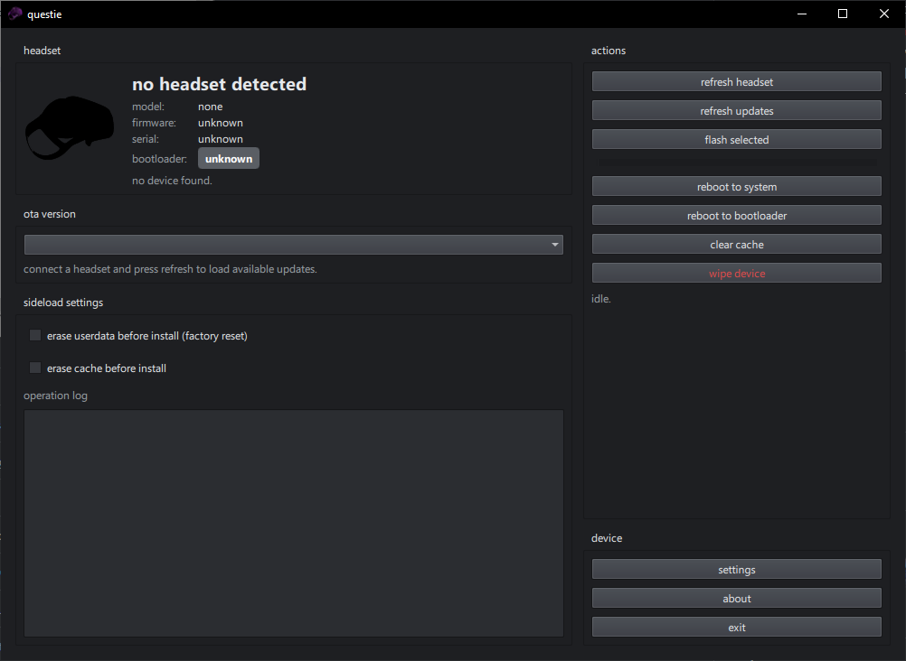



# questie

### a multitool for quest headsets

# ✨ so, what does it do?
questie allows you to upgade and downgrade firmware, simple as that.
i will probably add more things that it can do at some point (e.g root, bootloader unlock) but for now, only firmware swapping

# 🛠 how to build
you need to set up [qtbridge-csharp](https://github.com/qt/qtbridge-csharp)
then just build with `dotnet build`